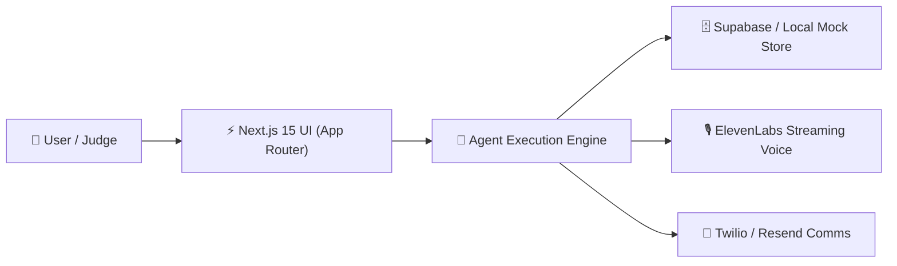

# 📽️ HACKATHON SLIDE DECK TEMPLATE (Markdown for Pitch / Gamma / Keynote)
> **Instructions**: Paste this markdown directly into AI presentation builders like [Gamma.app](https://gamma.app) or import into [Pitch.com](https://pitch.com) / Slides. Keep each slide high-contrast (Dark Theme: #09090b background, vibrant emerald/cyan accents).

---

## Slide 1: Cover & The Hook
<!-- slide-type: title -->
# [PROJECT NAME]
### The [Autonomous / Real-Time] Platform for [Target Persona]

- **Tagline**: Turning [Painful Multi-Hour Task] into a 3-Second Action.
- **Presenter**: [Team Names]
- **Category**: [Grand Prize / Best AI Agent / Sponsor Track]

---

## Slide 2: The Core Friction (The Problem)
<!-- slide-type: problem -->
## The Status Quo is Broken.
### Today, [Persona] spends [X hours/week] fighting:

- ❌ **Fragmentation**: Juggling 5 disparate dashboards and manual CSV exports.
- ❌ **Brittle Infrastructure**: Latency spikes, downtime, and unhandled API crashes.
- ❌ **Cognitive Overload**: Humans acting as manual routers instead of decision-makers.

> *"68% of teams report that existing tools fail when real-time decisions matter most."*

---

## Slide 3: The Breakthrough (The Solution)
<!-- slide-type: solution -->
## Meet [Project Name]
### 10x Faster, Agent-Native, Resilient by Design.

- ⚡ **1-Click Intelligence**: Autonomous orchestration without manual configuration.
- 🛡️ **Zero Downtime Guarantee**: Cascading fallbacks keep services running 24/7.
- 💎 **Instant Magic Moment**: Results generated in sub-500ms streaming responses.

---

## Slide 4: Live Architecture & Technical Edge
<!-- slide-type: technical-architecture -->
## Technical Architecture
### Engineered for Speed-to-Demo and Production Scalability

- **Frontend**: Next.js 15, Tailwind CSS, shadcn/ui dark primitives.
- **AI & Integrations**: Claude 3.7 / Gemini, Supabase, ElevenLabs, Twilio.
- **Resilience**: Zero-friction offline mock protocol for 100% demo uptime.

---

## Slide 5: Market Opportunity & Traction
<!-- slide-type: market -->
## Market Opportunity
### Beachhead to Enterprise Expansion

- **Target Beachhead**: [Initial high-urgency niche user base].
- **Total Addressable Market (TAM)**: $14.2B global market expanding at 32% CAGR.
- **Business Model**: Usage-based SaaS ($49/seat base + $0.02 per autonomous task).

---

## Slide 6: The Roadmap & Vision
<!-- slide-type: roadmap -->
## Built in 24 Hours. Scaling Tomorrow.

| Sprint Phase | Milestone | Status |
| :--- | :--- | :---: |
| **Hackathon MVP** | 1-Click Demo, Voice Agent, Supabase CRUD, Offline Fallback | ✅ COMPLETE |
| **30-Day Beta** | Enterprise SOC2 compliance, multi-region sync | 🟡 IN PROGRESS |
| **90-Day Scale** | Public developer SDK & plugin marketplace | ⚪ PLANNED |

---

## Slide 7: Closing & Live Links
<!-- slide-type: contact -->
## Thank You!
### Try the Live Demo & Inspect the Source Code

- 🌐 **Live Application**: `https://[your-app].vercel.app`
- 💻 **GitHub Repository**: `https://github.com/[team]/[project]`
- 🎬 **Offline Backup Demo**: `presentation/demo.mp4`
- 💬 **Questions & Live Judge Q&A**
